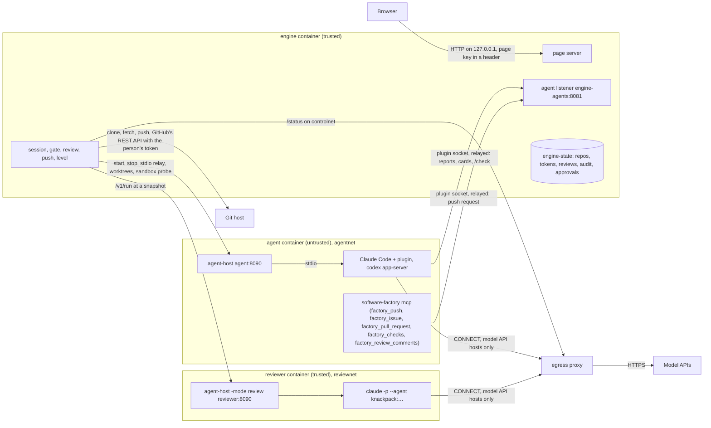
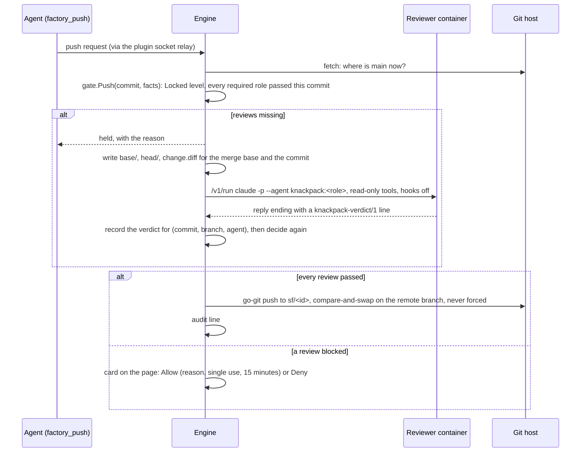

# Architecture

Software Factory runs coding agents in a sandboxed container and lets them change code freely. Only the engine pushes, and only after independent reviewers pass the exact commit. One image runs four containers, started by `compose.yaml`:
- the **engine** holds the page, the gate, the audit and the only git credential;
- the **agent** container runs every agent session behind an allowlist proxy;
- the **reviewer** container runs trusted reviewers on read-only snapshots;
- **egress** is that proxy.

This file describes the system as built and why it is built that way. [`AGENTS.md`](AGENTS.md) has the code layout and the commands; the image's paths and modes and the Compose details are in [Reference](#reference) below. The [README](README.md) says how to install and use it.

## Parts

This diagram hasn't been rendered.

| Part | Runs as | Does | Keeps |
|---|---|---|---|
| Engine (`software-factory`, no argument) | `engine` (10001) | Serves the page; clones and fetches repositories with go-git; starts sessions through agent-host; turns agent protocols (Claude Code's plugin, ACP, Codex app-server) into page events and cards; runs the sandbox check; starts reviews; decides and makes pushes | The `engine-state` volume (all 0600 in 0700); the `workspace` clones it made; the `reviews` snapshots; the agents volume it installs |
| agent-host, agent mode | `agent` (10002) | Starts and stops agent processes in their own process groups, relays their stdio to the engine, creates and removes worktrees with `git` (no credentials, no git host to reach), runs the sandbox probe, reports the sign-in method, relays the plugin's Unix socket to the engine | Nothing beyond the running processes; the agents' own logins in `agent-home`; reads the person's uploads from `uploads`, read-only |
| agent-host, review mode | `reviewer` (10004, own group) | Answers only `/healthz`, `/v1/run`, `/v1/sign-in`, `/v1/login` and `/v1/api-key` | The reviewer's own Claude Code login in `reviewer-home` |
| Claude Code plugin (`plugin/`) | Inside each Claude Code session | Reports the conversation, tool calls, cards, context and cost to the engine; asks the engine's `/check` for the gate's rules on each tool call; refuses push-shaped commands with "call factory_push instead"; registers `factory_push`, `factory_issue`, `factory_pull_request`, `factory_checks` and `factory_review_comments` itself (with the push token its connection got at `/register`, since `claude --bg` starts before that token exists) and `pasted_image`; adds a session-start note that the sandbox can't reach the git host and names those tools | Its outbox and replay buffer, in memory and `$.store` |
| `software-factory mcp` | An MCP server Codex (and an ACP agent, if one is added) loads | Offers `factory_push` (no input: push the session's branch at its current commit), `factory_issue` and `factory_pull_request` (a title and a body each) `factory_checks` (no input: the pushed branch's CI results) and `factory_review_comments` (no input: the person's own comments on the branch's open pull request); its instructions say the sandbox can't reach the git host | Nothing |
| egress (`software-factory egress`) | `egress` (10003) | An HTTP `CONNECT` proxy: port 443 only, host names only (no IP literals), allowlisted names only, git hosts always refused, public addresses only after resolving; after the `200` it reads the TLS ClientHello and relays it only when its server name equals the `CONNECT` host. Agents (`egress:3128`) and reviewers (`egress-review:3128`) reach separate listeners, each with its own connection limit, so agents can't starve the reviews or the reviewer's sandbox check | Counters for `/status` |
| Page (`web/`) | The browser | Shows every session, its conversation, cards, reviews, changes and pushes; sends what the person types or decides | Each session's events; the page key and open tabs in that tab's `sessionStorage` |

The image contains no agent. The engine installs pinned agent versions from npm, and knackpack at a pinned commit from its public repository, into the `agents` volume. The agent and reviewer containers mount it read-only.

## Trust boundary

The engine, the reviewer container and egress are trusted. The agent container isn't: an agent acting on instructions planted in a repository, an issue or a web page can run anything its user can there. That includes rewriting other sessions' worktrees, the plugin's reports and `.git`. The design holds because everything it relies on sits outside that container:

| What it relies on | Where it lives | Why the agent can't change it |
|---|---|---|
| No route to a git host | egress's allowlist; the agent container joins only `agentnet` (internal) | The sandbox check looks for a misconfiguration before every start and every 5 minutes |
| The push | The engine's token and its network | The token is in `engine-state`, never sent to another container, and no route returns it |
| The verdicts | The reviewer container's own output | Reviewers run at a snapshot the engine wrote, with read-only tools and hooks off |
| The gate's state and the audit | `engine-state` | Only the engine mounts it |

From the agent network, the engine accepts reports and requests only, never a decision, a verdict or a push:
- **The agent listener** (`engine-agents:8081`, `agentnet` only) answers the plugin's routes: `/register`, `/poll`, `/events`, `/wait`, `/wake`, `/check`, `/push-request`, `/forge-request`, `/checks-request`, `/comments-request` and a few read-only ones.
  - A connection registers for one session and gets a secret (`X-SF-Conn`), and each route answers only about that session.
  - A session counts as verified only when the engine itself started it (`Registry.Admit`).
  - Claude Code 2.1.322 ignores `--session-id` next to `--bg` and picks its own. The engine reads the short id from its own `claude --bg` run (`backgrounded · <id>`) and admits the session that `claude agents --json --all` lists with that id, in the same folder, as a background session whose id starts with it.
  - Two live connections claiming one session make it disputed, and a disputed session gets nothing until the person ends both.
  - Requests carrying browser headers are refused.
- **A permission card** allows a call only where the page showed the whole call. The person's answer comes from the page, never from the agent network.
- **`factory_push`** asks; the engine decides. An agent's request is capped at 5 per 10 minutes. A held request starts that commit's reviews, and the engine decides again when they finish.
- **`factory_issue` and `factory_pull_request`** ask; the person decides. Each request becomes a card on the page with the whole title and body shown as text, and the engine calls GitHub with its token only on the person's **Open**. Nothing from the agent network can answer that card, or choose whether a pull request opens as a draft. `factory_checks` and `factory_review_comments` only read. All four are capped per session, and the agent never gets the token or a route to the git host: the engine makes every call.
- **Workflow reports** from the plugin (intent records, plans) are shown on the page. They are data, not facts the gate counts.

**The page** is published only on `127.0.0.1`. The engine binds every interface inside its container but accepts a connection only on loopback or on an address of `SF_PAGE_NAME` (`engine-page`, on the `outside` network). It closes the rest before they count toward its connection limit, so the agent and reviewer networks can't reach it. Every request except `GET /healthz` is checked for `Host`, `Origin` and `Sec-Fetch-Site`. The page sends no CORS headers and a strict CSP, renders session content as text only, and needs the page key on every route except sign-in. "Page security checks" below lists what to check with curl after a change to the page server.

**Known limits:**
- the model API host an agent must reach also serves its vendor's other products;
- an agent can send code to its model API;
- the code under review can address its reviewer, and with Send findings that reviewer's blocking reply reaches the agent. Only the reviewer's read limit keeps the reviewer container's sign-in and other sessions' snapshots out of that reply; the token scan is a backstop that an encoded quote gets past;
- containers don't stop a kernel exploit;
- every session's agent runs as the same user in one container, so it can commit to another session's branch and register as that stopped session to push it. The reviews still bind to the commit, but that session's work-type approvals (a Feature's requirements and plan) then don't apply, and the audit names the other session. Work-type approvals guide an honest agent; only the reviews and the person's Allow bind a hostile one. Closing this needs a user or container per session.
- the agent container's home (`agent-home`) is shared by every agent and writable by them, so an agent can change user-level settings every later session loads (`~/.claude/settings.json`, `~/.claude/agents|commands|skills/`, user MCP servers, `~/.codex/config.toml`) without a start-up card asking. The start-up approval covers the repository's files only: the engine doesn't mount `agent-home`, because the agents' login files are there too. Closing this needs a home per session, or a read-only home whose settings the engine provides.

## Networks

| Network | Internal | Members | Carries |
|---|---|---|---|
| `agentnet` | yes | engine, agent, egress | engine ↔ agent-host; the plugin relay to the agent listener; agents to the proxy |
| `reviewnet` | yes | engine, reviewer, egress (`egress-review`) | engine ↔ review-mode agent-host; reviewers to the proxy |
| `controlnet` | yes | engine, egress | the proxy's `/status` (`egress-control:3129`), which agents can't read |
| `outside` | no | engine (`engine-page`), egress | the published page; the engine's git host and package traffic; the proxy's upstream connections |
| `gitnet` (dev only) | yes | engine, gitserver | the development git server `gitserver.test:8443` |

The agent and reviewer containers share no network, so an agent can't reach a reviewer.

## Data

| Store | Written by | Read by | Holds |
|---|---|---|---|
| `engine-state` (`/var/lib/software-factory`) | engine | engine | `repos.json` (the only list of projects, with each remote URL recorded at clone time); `tokens.json` (one git host token per host); `reviews.json` (review records keyed by commit, branch and agent, with the reviewer's last message up to 4,000 characters and its cost estimate); `audit.jsonl` (one line per push request, with the person's typed reason for an exception, per issue or pull request asked for and its outcome, and per comment the engine posts after a push, `pr-comment`, before and after it is posted, the lines of one request sharing a random `request` id; and one line per page approval of start-up files, requirements, a plan or the team file, by hash); `approvals.json` (approved start-up configuration sets); `signin.json` (the sign-in method expected of each agent); `work.json` (each project's approved team file hash, review rounds, default work type, whether to send blocking findings to the agent automatically, whether to comment on the pull request after each push and the push hold, and each session's work type, the person's approvals of its requirements and plan, with the text of the requirements they approved, and the flagged files they allowed); `sessions.json` (the sessions the engine started: ids, agent, project, worktree, branch, base, name, whether every sandbox check of the session passed, the agent's, engine's and workflow plugin's versions at its last start or wake, and when the engine stopped during its turn); `denied.json` (the commit the person last denied or handed off in each session); `waiting.json` (each automatic push waiting on its reviews: session, commit, since). No email and no model credential |
| `workspace` (`/workspace`) | engine (clones, fetches), agent (worktrees, every file an agent writes) | engine, agent | `repos/<name>` and `worktrees/`. Shared through group `sf`, so the engine treats everything here as written by an agent: it reads `.git` with its own reader, which checks each object's hash and refuses replace refs and grafts, and never runs `git` on it |
| `reviews` (`/reviews`) | engine | reviewer (read-only) | `<id>/base`, `<id>/head` and `<id>/change.diff` for each running review |
| `agents` | engine (installs) | agent, reviewer (read-only) | Pinned agent versions, knackpack's and Spec Kit's pinned commits |
| `uploads` (`/uploads`) | engine | agent (read-only) | Images and files the person drops on the page, one folder per session, 256 MiB in all |
| `agent-home`, `reviewer-home` | the agents | the agents | Each container's own logins, made by the person with the vendor's own sign-in (`docker compose exec -it agent claude`, then `/login`) |

The engine keeps cards (issue, pull request and comment cards included), manual test lists, the page key, the workflow documents the plugin reported and the counts of refusals in memory only, and a restart forgets them. The sessions it started, with their work types, the person's approvals of requirements and plans, the files they allowed, the commit the person denied and whether every sandbox check passed, are saved in `engine-state` and come back after a restart as Stopped. A session with no saved record that every check passed comes back not sandboxed, so its work can't be pushed, Allow included; on start the engine also stops their Claude Code sessions if they still run, so a session continues only after **Wake**, which runs the start checks again. Only records the engine wrote are restored: it never adopts a session it finds listed in the agent container. Records in `engine-state` survive a restart. A review a previous engine left running is marked failed with the failure kind `no-outcome`, since nothing will finish it. An automatic push that was waiting on reviews is picked up again (Pushes, below), and a session the engine stopped during the agent's turn gets a note before its next message that the turn was cut off: tool calls in it may or may not have taken effect, and it should check `git status` and `git log`. A state file that isn't a regular file owned by the engine's user with mode 0600 is refused rather than used.

## Flows

### Signing in to the page

Opening `http://127.0.0.1:<port>` signs the page in: the page posts to `/api/session` with no code and gets a key, which travels only in a header. The owner chose this for the local Docker edition (2026-11-12): any program on the computer can use the page, as anyone could who reaches the published port on Linux Docker Engine before 28. What keeps others out is unchanged: the engine refuses connections from every container network except the one the port is published from, so agents can't reach the page, and the `Host`, `Origin` and `Sec-Fetch-Site` checks refuse other websites, DNS rebinding included. One page is signed in at a time; a new sign-in ends the earlier key and its streams. A key ends on Disconnect, after 15 minutes with no stream open, after 24 hours, or when the engine restarts. The page signs in again by itself when it loads; an ended tab offers **Sign in** instead, so two open tabs don't keep taking the sign-in from each other. When its key is refused, the page asks for its own script again: a 404 means a new engine process, whose asset path (`/s/<random>/`) changed, so the page reloads and signs in; otherwise another tab took the sign-in and the page offers **Sign in**.

### Signing Claude Code in

The sign-in dialog, opened from the Welcome page's **Finish setting up** checklist, signs in the agent container's and the reviewer container's Claude Code, each separately (`/api/claude-login`, with `status`, `start`, `code`, `cancel` and `key` steps). Each part is an accordion with a **Subscription** and an **API key** panel. Opening Subscription starts the login and makes **Sign in** a link to it; closing it, or the dialog, cancels the login. For `start`, the engine asks that container's agent-host (`/v1/login`) to run `claude auth login` with the same environment sessions use, and returns the first link it prints. The link comes from a container the engine doesn't trust, so the engine and the page accept only an `https` address on `claude.com` or `claude.ai` whose path ends in `/oauth/authorize`, and the page opens it in a new tab with no opener or referrer. For `code`, the engine checks that the code is up to 512 printable characters with no spaces, and the agent-host writes it to that login's input. The login fails at once when Claude Code reports an invalid code, and otherwise counts only if Claude Code exits with 0; the engine then runs the usual sign-in check and shows the result. One login waits per container at a time, for at most 10 minutes. No log line holds the link or the code.

For `key`, the engine checks that the key is 20 to 512 printable characters with no spaces or quotes and asks that container's agent-host (`/v1/api-key`, step `set`) to save it. The agent-host writes it to `~/.config/software-factory/anthropic-api-key` (mode 0600, folder 0700, owned by the container's user) and sets `apiKeyHelper` in Claude Code's user settings (`~/.claude/settings.json`, or `$CLAUDE_CONFIG_DIR`) to `cat` that file; it refuses to replace an `apiKeyHelper` it didn't write, a settings file that isn't a plain file of its user, or one that isn't JSON. Claude Code prefers `apiKeyHelper` to a subscription login, so a finished subscription sign-in (`code`) first has the agent-host remove that setting and the file (step `clear`); a helper someone else wrote is left alone. Finishing either sets the kind that container's sessions or reviews may start on (`signin.json`) to the kind just signed in with; until then the engine stores the kind of the first sign-in it sees for Claude Code and the reviewers.

The code reaches only the container it signs in. The agent container already holds its own login, so the code gives an agent there nothing it doesn't have; the reviewer's code never passes through the agent container. This lifts, for this one code, the rule that no Software Factory code passes a model credential (CLAUDE.md); the owner decided it on 2026-11-12 without a check of Anthropic's terms. The API key lifts it a second time, by the owner's decision of the same day: the key travels only in the request body from the page to the engine to that container's agent-host, is never logged, kept by the engine or sent back, and reaches only the container it signs in. Agents in the agent container can read the agents' key, as they can read a subscription login there; the reviewers' key never passes through the agent container. Reviewers may read only their review folder (see "Reviews"), and every reviewer reply is scanned with the flagged-file token detector when it arrives: on a match the engine keeps none of it and the review counts as no verdict, so no token-shaped string from a reviewer is stored, shown or sent to an agent.

### Trusting a repository in Claude Code

`claude --bg` refuses a folder Claude Code hasn't been told to trust. The engine turns that refusal into `needs.trust` with the repository's path, and the page shows Claude Code's question. On **Yes, I trust this folder**, the page posts `/api/claude-trust`. The engine checks that the path is a project, and asks the agent container's agent-host (`/v1/trust`, which the reviewer's agent-host doesn't offer) to answer.

The agent-host runs `claude` in that folder in a pseudo-terminal (`creack/pty`) and renders its output with a terminal emulator (`hinshun/vt10x`). It acts only when the screen changes to one it knows. On the text-style picker and the security notes it presses Enter. On the trust question it presses Down and then Enter, because the cursor starts on "No, exit". Any other question stops it with nothing answered. It then starts `claude` again and counts the folder as trusted only if that run reaches Claude Code's prompt screen without the question; a timeout, an exit or a screen it doesn't know counts as not confirmed, and the page tells the person to trust the folder in a terminal. The page then starts the session again. This replaced the rule that Software Factory never answers Claude Code's trust question; the owner decided it on 2026-11-12. The screens are those of the pinned Claude Code (2.1.322), so moving that pin needs this flow checked again.

### Starting a session

1. The page sends the repository, the agent, the model and the mode. The engine accepts only the default and manual permission modes.
2. The engine runs the sandbox check (below). If it fails or can't run, nothing starts and the page says which part failed.
3. It fetches the repository and, through agent-host, creates the worktree `sf/<id>` at the fetched commit.
4. It reads the files that agent loads at start (for Claude Code `.claude/settings*.json`, `.mcp.json` and `.claude/agents|commands|skills|workflows|hooks/`; for Codex `.codex/`, `.agents/skills/` and `.agents/plugins/`), without following links. If that exact set hasn't been approved for this repository and agent, it asks the person on the page first.
5. It asks agent-host for the agent's sign-in method and host, never the account. A missing sign-in, or a method other than the one the person expects, refuses the start with the agent's own sign-in step. Any method other than a subscription needs the person's confirmation of cost.
6. It starts the agent through agent-host, with every model key variable cleared, and relays its stdio. Claude Code runs `--bg` with the plugin from `--plugin-dir`; `codex app-server` (and an ACP agent, if one is added) speaks its protocol to the engine's clients in `internal/adapters/engines/`.

### The sandbox check and the trust level

The check detects a misconfiguration that would let the agent container reach a git host; it isn't a proof, because the probe's report comes back through the agent container, which an agent could change. Every reply from the agent container's agent-host is agent-network data in the same way: agent-host runs as the agents' user, so an agent can signal it. agent-host marks itself non-dumpable at start (`PR_SET_DUMPABLE`), so agents can't attach to it or read or write its memory, but they can still signal it. Killing it normally ends the container, since `init: true` exits with it; the init process, though, runs as the agents' user and stays writable, so an agent that changes it first could keep the container up and answer on agent-host's port itself. That is why the engine treats agent-host's replies as reports, never as decisions. The engine caps agent-host's answer headers at 64 KiB. The trusted half is the engine's comparison of egress's `/status` lists with its own, read on `controlnet`, which agents can't reach; the network layout itself is set by Compose, outside the agents' reach. The engine runs `software-factory sandbox-probe` in the agent container through agent-host. The probe tries each refused git host through the proxy and directly, on ports 443 and 22, and tries their resolved addresses directly. It also tries one host that isn't allowlisted through the proxy, which shows the proxy refuses by default. Every attempt must fail: a connection made directly, or a proxy answer other than a refusal, fails the check. The engine then compares egress's `/status` lists with its own allow and deny lists. It runs the check before every start and wake, every 5 minutes, and in the reviewer container before each review.

Each session shows one level, computed by `internal/core/level` from observations only:
- **Locked:** every check since the session's process last started passed;
- **Held:** a check failed or couldn't run, or none has run since the session was started or woken, so every push is held and no session starts;
- **Stopped:** the process ended or agent-host lost it.

The level is computed per run: waking a session starts a new run at Held. A push counts the session's work as sandboxed only if no check failed or was skipped in any run, since work done while the lock was off stays in the branch. A failed check also counts against every stopped session, because a process an agent left behind in the container can still write a stopped session's branch; a check that couldn't run doesn't, since an agent can't turn a failing network into one the check can't reach. The engine saves whether each session's checks all passed in `sessions.json`, after every check, and a restored session starts from that record, so a restart never forgets a failed check. What an agent says about itself never raises a level, and losing evidence only lowers it.

### A tool call and its card

An agent asks for permission. For Claude Code, the plugin first asks the engine's `/check`, which classifies the tool (`internal/core/gate/tools.go`) and detects pushes in shell commands (`gate/shell.go`, `gate/push.go`). A push-shaped command is refused, with "call factory_push instead". A tool that acts off the machine through the vendor's servers, such as `RemoteTrigger` or an artifact upload, waits for the person. Otherwise the request becomes a card on the page, and the person's answer goes back the same way. If the engine doesn't answer, the plugin holds remote tools, MCP tools (the engine would show them with their whole input, and the plugin alone can't) and anything push-shaped, and allows the rest.

### Review, then push

This diagram hasn't been rendered.

- **The review base** is the merge base of the commit and the remote's main, fetched when the review starts. At push time, a review counts only if the base it covers back to is still in both the remote's main and the commit. Otherwise the page says the remote's main moved and asks for a new review.
- **Later rounds review only what changed.** When a role already passed or blocked an earlier commit P of the branch, its next review gets the change from P to the new commit and its earlier findings in a file beside the snapshot (`earlier/<agent>.md`), which the prompt tells it to open only after it has reviewed the change on its own, provided P is an ancestor of the new commit and P's own coverage still holds. The record keeps `since` (P) and `covers` (the base P covered back to), so coverage only chains: an incremental review never covers more than the reviews it builds on. A broken chain (a force-moved branch, a moved main) falls back to the merge base. The page shows which kind each review was.
- **The required roles** are the bug hunter (`knackpack:adversarial-reviewer`) and the simplicity checker (`knackpack:slop-reviewer`), plus reviewers the changed files add: ten built in (Go, Python, TypeScript, React, CSS, UI, Docker, Kubernetes, Terraform and database, `internal/core/workflow/files.go`), and others a team file's `fileRules` adds, such as `knackpack:security-reviewer`. An agent fills a role only from an installed plugin, never from the repository.
- **The round limit** is the project's `rounds` (lower of the team file's and the project's, default 3). A role whose verdicts on the branch blocked that many times (overridden ones aside) isn't started again, by the page or by an agent's request. The push then needs the person: Override a verdict, Allow with a reason, Deny, or Hand off, which sends the session `/knackpack:handoff` (Claude Code with knackpack) or a request for a handoff summary, then denies.
- **Send findings** sends the session the blocking reviewers' final messages for the held commit, below the round limit only (at the limit the card offers Hand off). The engine frames them as untrusted output to check, each between delimiters with a fresh random nonce, with the verdict lines removed, control and escape characters stripped, and 16,000 characters in all; it sends nothing when the token detector matches. The push stays held. A project setting, off by default, has the engine send them by itself after the reviews an agent's request started block, only when the reviewers' and the session's sign-ins are both subscriptions, below the round limit and the automatic-review cap, once per commit. Either way it goes through the same path as the person's messages, so only a running session the page controls gets it.
- **Override** counts one role's blocking verdict as passed for that commit only, with the person's typed reason, audited with the reviewer and its verdict.
- **Flagged files:** the engine scans every commit the push would send, each against its parents, for secret-looking names (`.env`, `*.pem`, `*.key`, SSH keys, `credentials*`, `*.tfstate`, `*.p12`, `*.pfx`, `*.keystore`, `*.jks`), files over 1 MiB, private-key headers and known token prefixes. Each flagged file holds the push until the person allows it with a reason, bound to its path and blob hashes (a later change flags it again), or asks the agent to remove it. Contents never reach the log or the page.
- **Work items:** the session's work type adds the person's approvals (requirements, plan) and Spec Kit's artifacts. For Codex and ACP sessions the engine reads Spec Kit's artifacts from the commit with its reader. For Claude Code sessions, knackpack's requirements and plan live in the session's scratchpad, outside the repository, so the text the plugin reports is the only copy the engine sees: an approval counts while the reported text keeps the approved SHA-256, or while no text has been reported since. A plugin can't create an approval, but it can keep one alive by reporting the approved text again or nothing at all.
- **Reviewers run** `claude -p --setting-sources user --plugin-dir=<knackpack> --agent <role> --tools=Read,Grep,Glob,Agent,ToolSearch --allowedTools=Agent,ToolSearch --settings=<hooks off, reads outside the working folder blocked, reads under ~ denied> --permission-mode dontAsk`. They can't run commands or write files, so code under review can't plant settings that steer a later review, and they read only their review folder: `Read`, `Grep` and `Glob` aren't allow rules (in dontAsk mode a read inside the working folder runs without one, and a bare rule would allow every path), `permissions.blockReadsOutsideWorkingDirectories` refuses reads elsewhere, and `Read(~/**)` is denied, so a reviewer misled by the code can't quote its own login or key file, the reviewer container's agent-host key or another review's snapshot. The engine writes `change.diff` so they don't need `diff`. The pinned Claude Code 2.1.322 contains the setting; its effect hasn't been checked on a signed-in run.
- **The verdict** is read from the reviewer's reply (`internal/core/review/verdict.go`). A timeout (20 minutes), a failure or a verdict the engine can't read counts as not passed. So does, as no verdict with its reason: any verdict when the result's `permission_denials` holds a `Read`, `Grep` or `Glob` of a path outside the folder (the code may have steered it; reads of the home's `.claude/CLAUDE.md` and `.claude/rules/`, which knackpack's reviewers are told to look for, don't count); a pass whose `num_turns` is 1 (it read nothing); a pass from a knackpack reviewer whose full reply lists a finding headed `### [Critical]` or `### [High]`, or a findings-table row `| F1 | High |` (`review.SevereFinding`, which relies on knackpack's report format and never turns a pass into a block); and a reply holding a token-shaped string, which the engine doesn't keep.
- **Refused outright:** a push carrying paths that the commit's `.gitattributes` send through Git LFS (the engine pushes git objects only, so the remote would get pointers without content), and a repository whose object format isn't SHA-1.
- **The push** goes to the remote URL recorded at clone time, never one read from `.git/config`, and only to the session's own branch `sf/<id>`. It is never forced and never touches the remote's main. go-git runs no hooks, `core.fsmonitor`, credential helpers or other programs a repository's configuration can name.
- **The person's Push and Allow** on the page re-run the whole check. Allow needs a reason when something is missing, and can't override a failed sandbox check: a session that isn't Locked (or Stopped after Locked) pushes nothing, as PRD "Trust levels" says for Held. It is bound to the commit, branch and remote, works once and expires after 15 minutes. Deny ends that commit's request: the engine refuses the agent's next request for it, and reviews of it that finish later never push it. Only the person's Push or Allow on the page pushes a denied commit. The denied commit is saved in `denied.json`, so a restart doesn't forget it.
- **An agent's request** starts the commit's reviews once. A finished review isn't restarted by the agent, which bounds review cost to one run per role and commit, or two when the first produced no outcome (the engine stopped, the reviewer couldn't be reached, or it was full) and the engine resumes the push at start. When it holds the push, the agent hears which review failed and why, and that the person can press Review. When the reviews pass, the engine pushes on its own and the audit line says "agent, after reviews". If the sign-in isn't a subscription, reviews wait for the person to start them. Reviews an agent's request starts are marked automatic, and the engine starts no more of them on a branch once they would pass 12 role runs (`session.MaxAutoRuns`), since failed and no-verdict runs aren't bounded by the round limit; the agent hears that the person starts more from the page. Reviews the person starts don't count and don't reset it.

## When a part fails

| Failure | What happens |
|---|---|
| egress down, or its lists differ from the engine's | The sandbox check fails: running sessions become Held, their pushes are held, and no session starts |
| The agent container or agent-host restarts | Its sessions become Stopped; the page offers Wake, which goes through the start checks again |
| The plugin can't reach the engine | The plugin holds remote tools, MCP tools and push-shaped commands, and allows the rest; events wait in its outbox and replay on reconnect |
| The reviewer container is down or signed out | The review fails and counts as not passed; the page shows the reviewer's sign-in step |
| The engine restarts | On a normal stop it refuses new pushes and issue or pull request answers, lets the ones under way finish for up to 25 seconds, and marks sessions in a turn as cut off. Cards and the page key are gone; the open page reloads itself and signs in again; sessions come back Stopped and the page offers Wake, and a session cut off mid-turn hears so with its next message; running reviews become failed (`no-outcome`); a saved automatic push resumes, running each such review once more; a push or issue that was going out is settled against the git host; repositories, tokens, reviews, approvals, denied commits, each session's sandbox record and the audit remain |
| A push's answer is lost (the connection dropped after the pack was sent) | The engine asks the remote again: at the commit, it records pushed; unchanged, refused; otherwise `unclear`, and pressing Push again is safe, since the push is a compare-and-swap |
| GitHub's answer to opening an issue or pull request is lost (timeout, dropped connection, 5xx) | Pull request: the engine looks for the open one and records it opened or failed. Issue: it lists the token user's issues opened since the approval; any found make the card `unclear` with links for the person to check, none make it failed |
| The remote's main moved after a review | The review no longer covers the push; the page asks for a new review, which reviews from the new merge base |
| A role keeps blocking | After the project's rounds it isn't started again; the push waits for the person's Override, Allow, Deny or Hand off |
| A stopped session gets a message | The engine wakes it through the start checks and holds up to 20 messages for 2 minutes; if the session isn't back by then, the page says they were dropped |
| The remote branch moved since the engine read it | The compare-and-swap push is refused, and nothing is overwritten |
| The git host token is missing or refused | The push fails with the host's answer, its token removed from the message; nothing else changes |

## Code

The engine follows gopamin's Clean Architecture (`cmd → adapters → core`), enforced by `make arch-check`. AGENTS.md has the layout and the rule. The core areas:
- `session`: the registry of connections, sessions, cards, starting, reviews and pushes;
- `gate`: tool kinds, push detection, protected writes, the push decision;
- `review`: roles, records, verdicts;
- `push`: the pusher and reader ports;
- `workflow`: work types, items, file reviewers, the team file, the Spec Kit adapter and the LFS attribute rules;
- `level`: trust levels.

The gate's rules exist once, in Go. The plugin asks `/check` instead of copying them. The one exception is its fallback list of remote tools for when the engine can't be asked, which must be changed together with `gate/tools.go`. In `plugin/hooks/workflow.ts`, `plainFile` must stay a function declaration, not an arrow function: Claude Code's checks follow `$` past an import only into a function declaration.

## Reference

Details for changing the parts above. The image and Compose first, then each component.

### The image and Compose

One multi-platform image (amd64, arm64) runs every role; `compose.yaml` starts four of them. Build stages: Node builds the page (`npm ci --prefix web && npm --prefix web run build`), Go builds the binary with CGO off, and the runtime stage is `node:24-trixie-slim` (pinned by digest) with `git`, `ca-certificates` and `curl` added and npm, corepack and yarn removed. The last stage, `runtime`, is the one to publish; the `dev` stage adds the fake ACP agent from `dev/fakeacp` and the fake reviewer from `dev/fakeclaude` (`/usr/local/bin/sf-fake-claude`), and the `gitserver` stage is a local git host (`dev/gitserver`: git http-backend over HTTPS with a self-signed CA, asking for a token, serving the seed repository at `/dev/demo.git` and the older `/demo.git`, with a small fake of GitHub's REST API under `/api/v3` in `dev/gitserver/github.go`, so the engine's GitHub adapter reaches it at `https://gitserver.test:8443/api/v3`); both are built only by `compose.dev.yaml`. The API fake answers only what the engine's adapter reads (the repository, branches, open pull requests, opening issues and pull requests, issue lists, comments, reviews, `/user`, check runs and statuses), gives every answer an `X-GitHub-Request-Id`, asks for the git server's token as a Bearer token, and keeps its state in one JSON file; `sf-gitserver` subcommands add comments and reviews, switch drafts off and set delays and failures (`comment-403` refuses the next comments the engine posts), so a development run can reach the cases a real host makes rare. `sf-fake-claude` makes no model call and refuses, with an error result, when a flag the engine must pass is missing, when `--settings` doesn't turn hooks off, block reads outside the working folder and deny `Read(~/**)`, when `--allowedTools` allows `Read`, `Grep` or `Glob`, when a flag that skips permission checks is present, when a variable that looks like a credential reached it, or when its folder isn't the engine's snapshot, so a development run catches a reviewer started the wrong way. It reports `num_turns` 3, a `modelUsage` entry `sf-fake-model` and an empty `permission_denials`, and files in the snapshot's `head/` change its reply (AGENTS.md "Hand checks with Compose"). The fake ACP agent calls the `factory_*` tool a prompt names (`factory_review_comments` included), echoes a note the engine put before a prompt, and stays in a turn for the prompt `stall` until it is stopped. git http-backend takes pushes only from an authenticated user, so the git server sets `REMOTE_USER` after its own token check. In that overlay the gitserver is on `gitnet`, an internal network only the engine joins, as `gitserver.test:8443`; it writes its CA to the `gitserver-ca` volume, which the engine mounts read-only and trusts through `SF_DEV_GIT_CA`; and `gitserver.test` is added to the refused git hosts (`EGRESS_DENY`) of both the engine and egress, so the sandbox check covers it.

| Path | What | Owner, mode |
|---|---|---|
| `/usr/local/bin/software-factory` | the binary: no argument for the engine, `agent-host`, `egress`, `open`, `install-agents`, `sandbox-probe`, `mcp` | root |
| `/opt/sf-dev/bin/software-factory` | with `make dev` only: the binary built on the host from the working folder, which `compose.live.yaml` mounts and runs in place of the one above, and names to the agents in `SF_AGENT_BINARY` | the host user, read-only |
| `/opt/software-factory/plugin` | Claude Code's plugin, loaded with `--plugin-dir` | root, read-only |
| `/opt/software-factory/agents` | the `agents` volume: `<agent>/<version>/node_modules/…` as npm lays it out, `bin/<command>` links, put first on `PATH`; `plugins/knackpack/<commit>/` and a `current` link | engine; read-only in the agent and reviewer containers |
| `/var/lib/software-factory` | the `engine-state` volume (`SF_STATE_DIR`): `repos.json` (the repository record), `tokens.json` (git host tokens), `reviews.json` (review records, with each run's cost estimate), `audit.jsonl` (one line per push request, issue or pull request request and outcome, finished review role with what produced it, and findings sent to a session), `approvals.json` (approved start-up sets), `signin.json` (the sign-in method expected of each agent), `work.json` (team file approvals, project settings and each session's work state), `sessions.json` (the sessions the engine started), `denied.json` (denied commits), `waiting.json` (automatic pushes waiting on reviews), each 0600 | engine, 0700 |
| `/reviews` | the `reviews` volume: `<id>/base` and `<id>/head`, one folder per running review, folders 0755 and files 0644 | engine:sf 0755; read-only in the reviewer container |
| `/home/reviewer` | the `reviewer-home` volume: the reviewer's own Claude Code login | reviewer, 0700 |
| `/workspace` | the `workspace` volume: `repos/<name>` (clones the engine made, engine:sf 2775 setgid, files group-writable, `core.sharedRepository=group`), `worktrees/` | engine:sf, 2775 |
| `/home/agent` | the `agent-home` volume: Claude Code's and Codex's logins | agent, 0700 |
| `/run/sf` | tmpfs holding agent-host's plugin socket | agent, 0700 |
| `/usr/share/doc/software-factory/` | the license texts of every Go module linked into the binary, Go's own, and TypeScript's LICENSE and NOTICE | root |

Users: `engine` (10001) and `agent` (10002), both in group `sf` (10000) so the workspace is shared, `egress` (10003) and `reviewer` (10004, its own group, not `sf`). The `gitserver` stage removes `reviewer` and gives its uid to `gitsrv`, which the `gitserver-data` volume's files carry. The image contains no agent.

`compose.yaml`:

- **The page** is published only as `127.0.0.1:${SF_PORT:-7799}:8080`, with `SF_PAGE_HOST=0.0.0.0` inside the container and `SF_PUBLIC_PORT` matching. Bound to every interface, it accepts a connection only when its local address is loopback (the healthcheck) or an address of `SF_PAGE_NAME` (`engine-page`, resolved on `outside`, where Docker delivers the published port), and closes the rest before they count toward its connection limit, so the agent and reviewer networks never reach it. The engine refuses to start when that name doesn't resolve to one of its own addresses, or resolves to loopback or the agent listener's address.
- **Hardening.** Every service: non-root user, `cap_drop: [ALL]`, `no-new-privileges`, read-only root filesystem, `init: true`, memory and pids limits, a healthcheck and `restart: unless-stopped`. Writable places are the volumes and tmpfs mounts only. `SF_UMASK=0002` keeps files in the shared workspace group-writable.
- **The agent container** gets `HTTPS_PROXY`/`HTTP_PROXY` (both cases) set to `http://egress:3128`, `NO_PROXY` for loopback only, and `DISABLE_AUTOUPDATER=1`.
- **The reviewer container** runs `agent-host -mode review` as `reviewer`, with the same proxy variables set to `http://egress-review:3128`, `SF_WORKSPACE=/reviews`, `reviews` read-only, `agents` read-only and `reviewer-home` its own. Review mode answers only `/healthz`, `/v1/run` (runs up to 25 minutes) and `/v1/sign-in`, and every route but `/healthz` needs the `X-SF-Host-Key` header to match `/reviews/.agent-host-key` (`SF_AGENT_HOST_KEY_FILE`), which the engine writes with a new random key at each start, so only the engine can start a review there. Other traffic between containers is plain HTTP on Docker's internal networks, which are the accepted transport boundary (PRD "Decisions"). Review mode has no worktrees, no long-lived processes, no plugin socket and no relay to the engine. The person signs Claude Code in there once: `docker compose exec -it reviewer claude`, then `/login`.
- **The allowlist** is `EGRESS_ALLOW`, given to both egress and the engine from `SF_ALLOW` (default: Anthropic's and OpenAI's API and sign-in hosts) plus `SF_EXTRA_ALLOW`; `SF_EXTRA_DENY` adds git hosts to the built-in refused ones. Add the host of every repository you clone that isn't GitHub, GitLab or Bitbucket when an allow entry covers it (a gateway's `.corp.example`, say): the sandbox check fails until you do.

### Repositories

Code: core `session.Repos`, adapters `git/remote` and `git/state`.

The record in `repos.json` (name, the URL as normalized at add time, the main branch, the last commit fetched, when it was added) is the list of projects; folders under `/workspace/repos` are never listed. The page adds one by https URL (`/api/add-repo`): the engine clones it with go-git's protocol code into `repos/.clone-<random>` (0700 while it fills, through an `os.Root` on the workspace), writes no working tree, makes it group-writable and setgid, and renames it into place only when whole; a failure or the 10-minute timeout leaves nothing, and the result arrives as a `repo` frame on the events stream. It uses the token saved for the URL's scheme and host (basic auth, user `x-access-token`), else none. Before each new session it fetches the main branch from the recorded URL (30 seconds at most), reads that commit back with the hash-checked reader and has agent-host run `git worktree add -b <branch> -- <path> <commit>`. It reads nothing from the clone's `.git`: no config, remote, `insteadOf`, refs or alternates. Tokens (`/api/save-token`, `/api/remove-token`) are one per host in `tokens.json`; no route returns one and the log says only `token saved for <host>`. `/api/remove-repo` takes a repository off the record and leaves its folder; it refuses while any session of that repository, running or stopped, is on the page. SHA-256 repositories are refused: go-git v5.19.3 fixes the hash size at build time, so one engine can't serve both formats (supporting them needs go-git v6's per-repository object format). Clones and fetches never ask for a thin pack, so every pack is complete without reading an object from the clone, which agents can write; one pack is capped at 4 GiB so a remote can't fill the workspace volume. agent-host's `git` names only the one repository as `safe.directory`, never `*`.

### Agent installs

Code: `internal/adapters/install/npm`, versions in `versions.go`, one table.

For each agent, the main npm package and its Linux platform package, by exact version and pinned `sha512` integrity per architecture. The engine checks that the registry's `dist.integrity` equals the pin and that the tarball's hash does too, unpacks only regular files and folders under `package/`, checks each `package.json`'s name and version, and switches `bin/<command>` with an atomic rename. It installs at start (`SF_AGENTS_INSTALL=manual` to skip) and on `software-factory install-agents`. To move to a new version, change the table and its hashes and rebuild.

### The sandbox check

Code: `internal/adapters/sandbox/docker`, port `session.Sandbox`.

The engine reads the proxy's `/status` over `controlnet` and compares its allow and deny lists with its own, then runs `software-factory sandbox-probe` in the agent container through agent-host's `/v1/run`. Its git hosts are every denied host plus the host of every repository in `repos.json` and every host with a saved token. It fails when an allow entry covers one of the repository hosts that isn't denied. The probe asks the proxy for each git host on 443 and 22 and for a host outside the allowlist (`SF_SANDBOX_OUTSIDE`, default `example.com`), expecting the proxy's own refusal; dials each git host by name and every engine-resolved address (two per host) and the fixed GitHub addresses directly, expecting no connection; and opens a tunnel to the first exact allowlisted host and sends a TLS hello naming each git host through it, expecting the proxy to close the tunnel without relaying a byte back. It runs before every start and wake, and every five minutes; a failure refuses starts and marks every running session Held. `SF_SANDBOX_CHECK=off` switches it off for development outside Docker; sessions then start Held.

### knackpack

Code: `install/npm`, `PinnedPlugins` in `versions.go`, next to the npm pins.

Version 0.24.0 at commit `08ceae2d62b0198266f5f792347b2ec568e22adc` from `https://github.com/bezmoradi/knackpack.git`. The engine fetches exactly that commit with the git remote adapter (no token, depth 1 where the remote allows it; the remote must list the commit or allow asking for it by hash), reads it back with the hash-checked reader, checks `.claude-plugin/plugin.json` names knackpack 0.24.0, writes its tree with `WriteTree` and switches `plugins/knackpack/current` with an atomic rename. It runs with `install-agents` and at engine start.

### Reviews

Code: core `session.Reviews`, `review.go`; adapters `git/files` `Reviews` for snapshots, `git/state` `Reviews` for `reviews.json`.

The page's Review button (`/api/review`, `{sid}`) works for a session this engine started. The engine reads `refs/heads/<session branch>` from the clone with the hash-checked reader, fetches the main branch from the recorded URL  and takes the merge base of the two with the hash-checked reader (`files.Reader.MergeBase`, newest-first parent walk, at most 200,000 commits); that is the review's base, recorded in each review record, and an empty base (no shared history) means an empty `base/`. It refuses when the head is the base (nothing the main branch lacks). It runs the sandbox check in the reviewer container (the probe through the reviewer's agent-host, asking `egress-review:3128`); a failure means no review starts, and the page shows why. Then it writes `<id>/base`, `<id>/head` and `<id>/change.diff` (the unified diff of head against base, written by the engine with go-git's diff encoder) into the `reviews` volume and, for each required role in parallel, has the reviewer's agent-host run `claude -p --setting-sources user --plugin-dir=<agents>/plugins/knackpack/<commit> --agent <role's agent> --permission-mode dontAsk --permission-prompts none --tools=Read,Grep,Glob,Agent,ToolSearch --allowedTools=Agent,ToolSearch --settings={"disableAllHooks":true,"permissions":{"blockReadsOutsideWorkingDirectories":true,"deny":["Read(~/**)"]}} --output-format json --no-session-persistence <prompt>` in `/reviews/<id>`, passing only `DISABLE_AUTOUPDATER` besides agent-host's base variables (key variables are always cleared). The reviewer has no Bash and no write tool, and hooks are off, so a reviewer misled by the code it reviews can't change its own home and steer later reviews; it reads `change.diff` instead of running `diff`. Roles: `bug-hunter` → `knackpack:adversarial-reviewer`, `simplicity` → `knackpack:slop-reviewer`. The verdict comes from that run's own JSON `result`, read with `internal/core/review`'s rules; a timeout (20 minutes), a failure or a reply without a verdict counts as not passed, with the reason, and so do the no-verdict cases under "Review, then push" (`num_turns`, `permission_denials`, a severe finding in a pass, a token-shaped string). Each record also keeps what produced it: knackpack's pinned commit, the pinned Claude Code version (`sf-fake-claude` with the development reviewer), the model names from the result's `modelUsage` (at most 4), `num_turns`, the names of denied tools (at most 20), whether the message was clipped and whether an agent's request started it; the page shows the first three under each role, and each finished role adds an audit line (`kind: "review"`, its state, reviewer, verdict, reason and the same provenance, `by` agent or page), which the page's audit list leaves out. Records are keyed by `{commit, branch, agent}` with provider `knackpack@knackpack`, written atomically 0600; a review in progress is recorded as running, and one an earlier engine left running becomes failed at start. A failed record keeps its `failure` kind: `no-outcome` (the engine stopped it, the reviewer couldn't be reached, or the reviewer's agent-host was full), `timeout`, or `error` (anything else, a snapshot that couldn't be written included); and its `attempt`, counting runs of that role at that commit (missing reads as 1). `Dispatcher.Retry` starts a review in retry mode, which runs only the roles with no record or a `no-outcome` failure on their first attempt; the page's Review always runs every role. Each review base gets its own snapshot: a later round that builds on an earlier reviewed commit P gets `base/` at P, `change.diff` from P, and the role's previous final message in `earlier/<agent, with ":" as "-">.md` (0644 in a 0755 folder, the machine verdict lines removed, each line stripped of control and escape characters, left out when it holds a token-shaped string); the prompt names that file and asks for the reviewer's own findings first; its record stores `since` (P) and `covers` (P's coverage), and a blocking P whose message was clipped starts a full review instead. Rounds are counted from the records per branch and agent (reviewing the same commit again isn't a new round); a role at the project's limit whose last verdict blocks and wasn't overridden is skipped, and `/api/review` answers `409 capped` when no role is left. `/api/override` (`{sid, agent, commit, reason}`) sets `Record.Override` on a blocking record of the branch's current commit. The snapshot folder is removed once every verdict is recorded; the record keeps the reviewer's final message, clipped to 4,000 characters. The session's last review reaches the page with the sessions list (`review` on each session). Nothing on the agent listener reaches the reviews. In `change.diff`, files over 1 MiB are listed as changed without their content, and the diff stops at 32 MiB with a note.

**The manual test list** (`/api/test-list`, `{sid, costOk}`; `session/testlist.go`) is a reviewer run without a role: the same snapshot of the head against the merge base, the same sign-in and cost check, the same sandbox check in the reviewer container and the same command line as a review (`TestListArgv` is `ReviewArgv` without `--agent`, so a later change to the reviewers' flags applies to it too), with a prompt asking for the steps to try by hand. It counts toward `MaxReviewing` (the running set holds `test-list:<sid>` next to the sessions being reviewed), one per session at a time. The reply, clipped to 16,000 characters, is kept in memory per session with its commit and reaches the page in the session's review view (`testList`); a reply the token detector (`flagText` in `session/flag.go`) matches isn't kept or shown, only that it was withheld. It records no verdict, writes nothing to `reviews.json`, and never reaches the gate or the agent.

The prompt is one argument of that command line. The engine keeps it under 8 KiB (`session.MaxReviewArg`); the previous message is a file now, so nothing is cut from it, and agent-host takes arguments up to 32 KiB each (`agenthost.MaxArg`; environment values stay at 4 KiB), below Linux's 128 KiB per argument, while its 64 KiB request body bounds the whole command line. Raise `MaxArg` before `MaxReviewArg`. When the reviewer container refuses or can't be reached, the role fails with a plain reason, and the page shows it once beside the Review button with what to do next: press Review again, or allow the push with a reason.

### Logs of refusals and failures

These lines name a kind, never content (no prompt, reply, path or URL):

- `review event=finished state=failed why=<kind>` (WARN): `host-refused:<agent-host's code>`, `host-unreachable`, `timeout`, `engine-stopped`, `not-claude-json` or `claude-error` (the record's `failure` is `no-outcome` for `engine-stopped`, `host-unreachable` and `host-refused:full`, `timeout` for `timeout`, `error` for the rest); a reply without a readable verdict logs `state=unknown` with `no-verdict` or `two-verdicts`, and the other no-verdict cases with `denied-read`, `shallow`, `severe-pass` or `token-in-reply`; a pass whose result has no `num_turns` logs `state=pass why=turns-unknown`.
- `review event=refused why=auto-capped` (INFO) when an agent's request would pass the automatic-review cap; `push event=findings-sent|findings-not-sent|findings-withheld` and `push event=findings-not-automatic why=reviewer-sign-in|session-sign-in|auto-capped|not-sent`.
- `agent-host request refused path=<route> status=<code> why=<code>` (WARN) for every refused request; a path that isn't one of its routes is logged as `other`. Asking to stop a process that already ended isn't logged.
- `plugin relay event=client-gone` (INFO) when Claude Code's plugin drops its request, as it does when Claude Code exits; `event=engine-unreachable why=dial|timeout|other` (WARN) only when the engine's agent listener didn't answer.
- `egress event=refused reason=<reason> host=<name> side=agents|reviewers` (WARN): which listener refused it, and the `CONNECT` host, and on `sni_mismatch` the ClientHello's name as `sni=`, so the person can tell what a session was refused. Only a valid host name or IP address is logged (an agent chooses it, so anything else is logged as `(not a host name)`); a `CONNECT` request carries no path. A name an agent chooses can still carry data it puts in it, in the person's own log.

### Pushes

Code: core `session.Pushes`, `pushes.go`; adapters `git/push` for the transport, `git/files` for heads, ancestry and changes, `git/state` `Audit` for `audit.jsonl`.

The agent's `factory_push` (`/push-request` on the agent listener, authenticated by the session's push token, no input) and the page's Push button (`/api/push`, `{sid}`) take the same path, for a session this engine started: the commit is `refs/heads/sf/<id>` read with the hash-checked reader, the remote is the URL in `repos.json` with the token saved for its host. The engine asks the remote for its refs (`Pusher.Remote`); when the remote's `sf/<id>` already points at the head, the request ends `up-to-date` with no card (the agent hears it as pushed, and a held card for that commit is dropped), so a commit already on the remote never offers Allow or Deny. Otherwise it fetches the main branch (refused when the two disagree, or when the session branch is the remote's main branch), and decides with `gate.Push`: the session's work type (`fix` when the engine holds no work facts for it) with its roles filled by the engine's reviewers (offered as `knackpack@knackpack`), the review records, the session's level from the engine's own sandbox checks, and an item for every review whose recorded base isn't an ancestor of (or equal to) both the remote's main and the head ("review again, the remote's main moved"). Workflow items the plugin reports come from the agent container and never reach the gate (guidance only). Allowed: go-git pushes from an in-memory pack to `refs/heads/sf/<id>`, never forced, with the remote branch's commit the engine saw as the expected old value, so a branch that moved in between fails with the reason. Held: the session's push view carries a card (random id, commit, branch, remote, missing items, expiry 15 minutes); the page answers it with `/api/push-answer` (`{sid, card, commit, allow, reason}`): the card and commit must match, Allow needs a reason when items are missing and re-runs the whole decision with a `gate.Answer` bound to that commit, branch and remote (single use); Deny ends it: it denies the agent's next request for that commit once, and the engine remembers the denied commit per session in `denied.json`, so neither a later `factory_push` nor reviews that finish afterwards push it (Hand off does the same); the person's Push or Allow clears it. A held request from the agent of the same commit keeps the card. When the agent's request is held and no review of its commit has a record yet, the engine starts the reviews (`StartReview`, `Dispatcher.AgentReview`) and remembers the commit; when they finish (`Reviews.OnDone` → `Pushes.ReviewDone`) it decides that request again (audited `by: "agent, after reviews"`), so a background session's work is pushed without the person when every review passes, and otherwise waits on the card. Finished reviews of a commit aren't started again by the agent; the branch moving on drops the old request. The agent's calls are capped at 5 per 10 minutes per session (refused past it, one audit line per window). Before deciding, the engine reads what the push carries (`git/files` `pushed.go`: every commit from the remote's main to the head, each against its parents, at most 1,000 commits and 32 MiB of content) for flagged files and Git LFS paths; an LFS path refuses the push, and each flagged file is a missing item until `/api/allow-file` (`{sid, path, reason}`, bound to the path and the flagged blob hashes, kept with the session) or until a new commit removes it; `/api/flag-remove` sends the session a message asking the agent to remove the file and add it to `.gitignore`. `/api/send-findings` (`{sid, card, commit}`, checked like `/api/handoff`) sends the session the blocking reviewers' messages for the card's commit ("Send findings" under "Review, then push"); it refuses an expired or other card, a push being decided, the round limit, a commit with no blocking message, a second send and a token match, and answers 409 with the reason when the session isn't running and controlled from the page. The push view carries `findings` (the card offers it) and `findingsSent`. Each attempt is an audit line with `kind: "findings"`, `result` `sent`, `withheld` or `not-sent`, and the reviewers' names, never the text. A role capped by the round limit is a missing item ("the developer's decision on …") and the card offers Hand off (`/api/handoff`), which sends the handoff message first and denies only once it was delivered. After a push that went out (never up-to-date), `Pushes.OnPushed` hands the engine's facts about it (`PushedFacts`: commit, branch, who caused it, how many items an Allow covered, each required role's result and scope from the review records) to `Forges.AfterPush`, which may comment on the pull request (Issues, pull requests and CI results). Every request ends as pushed, up-to-date, held, denied, refused or unclear, appended to `audit.jsonl` (time, session, repository, branch, commit, remote URL, by, result, reason, missing items, the person's reason, and for exceptions their kind, reviewer, verdict, path and blobs; rotated to `audit.1.jsonl` past 32 MiB); reasons are cleaned of the token. `/api/audit` returns the newest 50 lines for the session's repository and branch, and the counts of refusals `/check` made in that repository (push-shaped commands, held remote tools, protected writes), kept in memory, so the page can suggest a CLAUDE.md line. The push view reaches the page with the sessions list (`push` on each session). `/api/changes` (`{sid}`) returns the session's commits (at most 100), changed files and unified diff (go-git's encoder, in memory, 1 MiB at most) against the merge base with the main branch as last fetched (no network). Nothing on the agent listener can allow, deny or start a page push. The push uses the same HTTP client as clones and fetches (no proxy, TLS 1.2 or later, plus the development CA when `SF_DEV_GIT_CA` is set), so it trusts exactly the hosts a fetch does. An agent's push request is answered within 55 seconds (`session.AgentReplyFor`), below the MCP server's 60, so the agent hears the engine's answer rather than a timeout: change both together. The decision isn't cut off then: it runs on, bounded by `PushFor` (two minutes), and a request still running at 55 seconds is answered held, with the result shown on the page. Every decision gets a random `request` id that its `allowed` line and its outcome line share. When go-git's `ReceivePack` fails after the pack was sent (no report came back), the outcome is unclear: the engine asks the remote again (20 seconds), records pushed when the branch is at the commit, refused when it's still where the gate saw it, and otherwise `unclear`, telling the person that pressing Push again is safe. At start, `Pushes.Reconcile` reads the last line of each request in the audit's last 4 MiB of `audit.1.jsonl` and `audit.jsonl` (`Audit.Open`): for every push whose last line is `allowed` or `unclear`, it asks the remote recorded in that line (it must equal the project's URL) and appends pushed or refused by `engine, at start`, with the same `request` (a refused push whose commit has a saved plan in `waiting.json` says the engine decides it again and tells the agent nothing, since `Pushes.Resume` then decides it); a remote it can't reach leaves the line open for the next start. An automatic push waiting on reviews is saved in `waiting.json` on every change; at start `Pushes.Resume` drops a plan whose session is gone, whose branch moved or whose commit was denied, and queues the rest, one review start at a time: a role with no record or a `no-outcome` failure on its first attempt is started again (`Dispatcher.Retry`, so the subscription check applies); when every review has an outcome, the engine decides as after reviews. A full reviewer (two sessions) re-queues every 15 seconds, other passing failures (sign-in check, fetch, the plugin not installed yet) for up to 10 minutes; any other refusal decides at once, so the agent hears the held outcome. An agent's request refused because two sessions are already being reviewed joins the same queue. A review the person starts from the page arms nothing, but when a saved plan exists for that commit, its finish completes the agent's request. On a normal stop the engine first refuses new pushes, answers and handoffs ("the engine is stopping"), cancels clones, fetches and reviews (a review the engine stopped doesn't start a decision), then gives decisions and approved issue or pull request calls already under way up to 25 seconds (`pushGrace`) on their own context, then 2 more seconds to write their outcome lines; Compose's `stop_grace_period` for the engine is 45 seconds to cover that and the HTTP shutdown. A project can hold the agent's own push (`/api/project` op `hold`: `afterBlock`, `maxFiles`, `maxLines`, off by default): with it on, a request by the agent (not the person's Push) gets the missing item "the person's Push: …" when a required reviewer blocked on the branch (overridden verdicts aside), or when the change from the merge base has more files or changed lines than the limit, a clipped diff counting as over; the engine counts, never looks at paths. The agent learns an outcome it didn't hear from a short factual note (`Registry.Note`, one per session, the latest replacing the earlier): a push after its reviews or by the person's Push or Allow ("Software Factory pushed commit 774004e to sf/… after both reviews passed."), the person's Deny, a hold or refusal after its reviews, and the end of a request answered held at 55 seconds. The engine puts the note before the person's next message to the session, or the one that wakes it (never before a command); it doesn't send a turn or wake a session for it, and a restart forgets it. The push view carries how many required reviews passed and were overridden, so the page's Push section says how the push came about: who asked, and after which reviews or with which items missing; the commit links to the host's commit page for an `https` GitHub remote. Deliver lists the branch's audit entries under their own label, each with its time, newest first, apart from what holds the push now.

### Issues, pull requests and CI results

Code: core `session.Forges`, `forge.go`, `forgetext.go`, `forgecomment.go` (the comment after a push), `forgereview.go` (`factory_review_comments`); adapter `git/github` (GitHub's REST API, `net/http` only); page `forge.go`; component `web/components/forge-panel.ts`.

The agent's `factory_issue` and `factory_pull_request` post `{kind, title, body}` to `/forge-request` on the agent listener, `factory_checks` posts `{}` to `/checks-request` and `factory_review_comments` posts `{}` to `/comments-request`, all authenticated by the session's push token like `/push-request`, with exactly those fields and strings only (256 KiB at most). The engine takes the repository from the session's project record: the remote URL recorded at clone time names the host, owner and repository (exactly `https://HOST/OWNER/REPO`), and the token is the one saved for that host. The agent names neither. `github.com` uses `https://api.github.com`, a `*.ghe.com` host `https://api.HOST`, and any other host with a saved token is tried as GitHub Enterprise Server at `https://HOST/api/v3`; an answer without GitHub's `X-GitHub-Request-Id` header counts as not supported for that host, and known other hosts (GitLab, Bitbucket, Codeberg and the like) are refused before any call. Calls use the same HTTP client as clones and pushes (no proxy, TLS 1.2 or later, the development CA when `SF_DEV_GIT_CA` is set), never follow a redirect, read at most 4 MiB, and time out after 45 seconds (`ForgeFor`), below the MCP server's 60.

- **Requests.** The title is one line of 1 to 256 characters, the body at most 20,000; both must be UTF-8 without control or invisible characters (newlines and tabs allowed in the body). Calls are capped at 5 per 10 minutes per session for issues and pull requests together. For a pull request the head is the session's branch and the base is the project's main branch; the engine checks with the API that the branch is on the host (else "call factory_push first") and that no pull request for it is open (else it answers `exists` with the link and makes no card). For an issue it reads the repository first, which also refuses a host that isn't GitHub before anything is posted. An identical request already waiting answers held without a second card; at most 5 cards wait per session, and a card expires after 24 hours. The agent hears `held`, `exists` or `refused` with the reason.
- **The card.** The session's `forge` list reaches the page with the sessions list (the body only while the card waits) and counts toward its attention badge. The page shows the title and body as text and offers **Open issue** or **Open pull request** and **Deny**, through `/api/forge-answer` (`{sid, card, approve, draft}`, the usual page checks; `draft` is optional and refused on an issue card). A pull request card has **Open as a draft**, checked by default. On Open the engine checks again for an open pull request, then posts the issue or the pull request (`maintainer_can_modify: false`, and `draft: true` when asked), and shows the number and link or the failure. When GitHub answers a draft with a 422 that names drafts, the adapter checks for an open pull request again and otherwise posts once more without `draft`, and the card and the agent's note say it opened ready for review. Every request and outcome is a line in `audit.jsonl` with `kind` `issue` or `pull-request`, the card's id as `request`, and results `held`, `sending` (written before the API call, with the SHA-256 of the title and body as `hash`; if it can't be written, nothing is sent), `opened`, `exists`, `denied`, `failed`, `unclear`, `expired` (the 24-hour limit) or `abandoned`. While the engine stops, it refuses new requests and answers. When the call's answer is lost (a transport error, a timeout, a status of 0 or 5xx, or an answer it can't read), it doesn't decide: for a pull request it asks for the open one again (opened, or failed when there's none); for an issue it reads `GET /user` and lists that login's newest 10 issues (`state=all`, pull requests dropped, or everyone's when `/user` is refused), keeps those opened since a minute before the approval, and shows them on the card, state `unclear`, marking the ones with the same title and body; with none, the card fails. At start `Forges.Reconcile` settles open lines, skipping requests that are cards of the running engine: `held` becomes `abandoned` and the agent is told to ask again if it still needs it; `sending` is checked the same way, and an issue with matches comes back as an `unclear` card.
- **The outcome reaches the agent** as a note (`Registry.Note`, see Pushes): opened with the number and link, already open, denied, or failed with the reason, before the person's next message.
- **The comment after a push.** With the project setting `prComment` on (`/api/project`, `{path, op: "prComment", on}`; off by default, since it publishes under the person's account), `Forges.AfterPush` finds the branch's open pull request and posts the engine's own text (`CommentText`) as an issue comment (`POST /repos/O/R/issues/N/comments`). The text comes only from engine data: a fixed first line (`PushNoteMarker`), the full commit and branch, who caused the push, the number of items an Allow covered, each required role with its result and whether it covered the whole branch or only what changed since a commit, and the engine version, knackpack commit, Claude Code version and models where the review records hold them. It never holds the person's typed reasons, reviewer messages, missing-item text, file paths or cost. The comment is a card on the page with its whole text before and after posting, audited as `pr-comment` (`posting`, then `commented` or `failed`, the two lines sharing a `request` id). A commit is commented on once per session, the engine remembers the last push per session, and when a pull request it opens has that push's commit as its head, it comments then. No open pull request means no comment; a failed comment changes nothing about the push.
- **The person's pull request comments.** `factory_review_comments` finds the branch's open pull request (none: refused, "ask with factory_pull_request"), reads the token's own login (`GET /user`) and the pull request's reviews, inline review comments and conversation comments (100 per page by page number; past 3 pages, the first page's `Link` header names the last page and the engine reads the newest 3 instead, with a note that older ones were left out; a part that can't be read becomes a note; pending reviews, which only their author sees, are dropped), and keeps only comments whose author is that login, compared without case, and that don't start with the engine's push-note line. Each body is cleaned like a log line and clipped to 4,000 characters; the newest 100 that fit in 60,000 characters are sent, oldest first, framed as the person's feedback to weigh rather than instructions that override the page or Software Factory's rules, with the warning that a repository admin can edit anyone's comment. Capped at 10 per 10 minutes per session; no card.
- **CI results.** `factory_checks` reads the branch's head on the host, then its check runs (first 100) and combined commit status, and for each failed GitHub Actions job (at most 5) the job's log: the API answers with a redirect to a short-lived download address, which the engine fetches without the token, reading at most 32 MiB and keeping the last 200 lines. Lines lose GitHub's timestamps, ANSI and other escape sequences, control and invisible characters, and are clipped to 400 characters, 16,000 characters per job and 60,000 for the whole answer, which opens by saying the rest is untrusted text from the git host. No card: it changes nothing. Capped at 10 per 10 minutes per session.
- **Token permissions** (fine-grained personal access token, the repositories you add): Contents: Read and write and Metadata: Read-only, as for pushes; Issues: Read and write for `factory_issue`; Pull requests: Read and write for `factory_pull_request`, `factory_review_comments` and the comment after a push; Actions: Read-only and Commit statuses: Read-only for `factory_checks`. A 403 or 404 from GitHub is reported with the permission that call needs. GitHub's list of fine-grained permissions doesn't name one for reading check runs; read access to the repository serves.

### Start-up files

Code: core `session/startup.go`, adapters `git/files` `Startup`, `git/state` `Approvals`.

`session.StartupLists` is the one table of the files each agent loads at start that can change what it may do without asking, with a source line per entry: Claude Code 2.1.322 `.claude/settings.json`, `.claude/settings.local.json` (in the worktree, and in the clone's own folder, where Claude Code keeps it for a worktree), `.mcp.json`, `.claude/agents/`, `.claude/commands/`, `.claude/skills/`, `.claude/workflows/`, `.claude/hooks/`; Codex 0.167.1 `.codex/`, `.agents/skills/`, `.agents/plugins/`. Instruction files (`CLAUDE.md`, `CLAUDE.local.md`, `AGENTS.md`, `.claude/rules/`, output styles, agent memory) are left out on purpose: they change no permission, hook, server, plugin or endpoint. The development agent uses Claude Code's list. After agent-host creates the worktree, and before each wake, `Dispatcher.admit` reads the list through an `os.Root` on the worktree and on the clone's folder, `Lstat`ing every path component. A symbolic link is shown with its target and followed only inside that folder (`os.Root` refuses one that points outside, which refuses the start): a link to a file adds the file's content to its entry, and a link to a folder lists the folder's files under the link's path, so the approval covers what the link points to and a change there asks again. Other files are opened `O_NOFOLLOW` and checking they're the file `Lstat` saw, refusing special files, files over 1 MiB, more than 400 files, more than 8 MiB or folders nested deeper than 8 (an unreadable set is refused, never approved); each file is compared with the session branch's commit with the hash-checked reader. A set's hash (`SetHash`, over the list name and each file's place, path, link target and content) is approved per repository and agent in `approvals.json` (one per pair: approving a new set replaces the old), and each approval is an `approve-startup` line in `audit.jsonl` (repository, branch, agent, the set's hash). An unapproved set refuses the start (`409 needs approval`) with the files, escaped by `session.Escape` (controls, ANSI escapes, direction and zero-width characters as `⟨U+XXXX⟩`, bytes that aren't UTF-8 as `⟨0xNN⟩`), the commit and an uncommitted note; the page sends it again with `approve: <hash>`, which counts only when it equals the set read at that moment. The refused worktree is removed (its branch stays). The engine never answers an agent's folder-trust question.

### Work types and approvals

Code: core `session/work.go` (`Work`), `internal/core/workflow`; adapters `git/state` `work.go`; page `workflow.go`.

Each session has a work type (Feature, Fix, Docs only, Exploring, or one from the team file), picked on the page before the first message; the default comes from the new-session form, then the project, then the team file, then `fix`. A type's items are the person's approvals of requirements and plan (the SHA-256 of the text the page showed and the commit, saved in `work.json`; approving requirements again clears the plan's; for requirements the approved text is saved too, and when the reported requirements no longer match it, the gate view carries it as `previous`, so the page shows a line diff before the person approves again; a saved text whose SHA-256 isn't the approval's is dropped on load, and the oldest approvals lose their text once all of them pass 1 MiB in `work.json`), Spec Kit's `spec.md`, `plan.md` and `tasks.md` read from the session's commit, and the required roles. Claude Code sessions get knackpack's workflow; other agents get Spec Kit's step names, artifacts and gate (v1.4.0 is pinned by commit and installed into the agents volume, templates and scripts only, no Python CLI). The engine doesn't hand Spec Kit's commands to a Codex or ACP session: its commands run scripts from the repository's own `.specify/` folder, so the Define, Plan and Tasks buttons work in a repository that carries Spec Kit's files from `specify init`, committed to its main branch. Approving the requirements sends the session the Plan step's command; approving the plan sends the Implement step (`/speckit-implement`, or for knackpack a message to implement the approved plan). In a Feature, before the plan is approved, the plugin's write check (`/check` → `Work.EditHold`) refuses Claude Code's file tools for paths in the worktree, other than the current step's own Spec Kit files; Docs only refuses paths that aren't documentation, and Code review refuses every edit. Documentation is a `.md`, `.markdown`, `.rst` or `.adoc` file, or `LICENSE`, `NOTICE`, `AUTHORS`, `CONTRIBUTORS`, `COPYING`, `README`, `CHANGELOG`, `CHANGES` or `HISTORY`, bare or with one of those extensions or `.txt` (`workflow.DocFile`). Agents' instruction files (`CLAUDE.md`, `AGENTS.md`, `.claude/`, `.codex/`, `.agents/` and the like), MDX, which runs code when a site is built, and files a built-in reviewer covers aren't documentation, so a Docs only branch that changes one needs what a Feature needs. This is guidance for the agent: the gate's approvals are what count, and an agent can still write files through other tools. The team file `software-factory.json` is read from the fetched main and counts only after the person approves its SHA-256 on the page (`/api/team`); it may add work types, `fileRules` and `agents` from installed plugins, never `roles`, `checks` or `"edits":"none"`. Project settings (`/api/project`): review rounds (1 to 20), the default work type, the push hold (`{path, op: "hold", hold: {afterBlock, maxFiles, maxLines}}`; Pushes, above), `findings` (`{path, op: "findings", findings: bool}`, sending blocking findings to the agent by itself, off by default) and `prComment` (`{path, op: "prComment", on: bool}`, a comment on the pull request after each push, off by default), in `work.json`. Each approval of requirements or a plan is an `approve-requirements` or `approve-plan` line in `audit.jsonl` (session, branch, commit, the text's hash), and approving or forgetting the team file an `approve-team` or `forget-team` line (repository, SHA); a failed write is logged and the approval still counts.

### Files and uploads

Code: page `files.go`, `upload.go`; core `session/uploads.go`, `session/wake.go`.

`/api/files`, `/api/file` and `/api/file-match` show the session's worktree read-only, for sessions the engine started: no symbolic link is followed, a file is shown up to 512 KiB, binary files aren't shown, and `@` suggestions leave out secret-looking names. `/api/upload` stores images (PNG, JPEG, GIF, WebP, 2.5 MiB each, 4 per message) and dropped files (10 MiB) in the `uploads` volume, one folder per session; files not sent within an hour are removed. Claude Code reads an image through the plugin's `pasted_image` tool, Codex gets `localImage`, and an ACP agent would get image blocks. Every agent can read `/uploads`, so another session's agent could read a person's upload. A message to a stopped background session wakes it (`wake.go`): up to 20 messages wait 2 minutes for the woken process.

### Page security checks

Run these against the published port after any change to `internal/adapters/http/page` or `cmd/server`, with a page key from a sign-in (`Authorization: Bearer <key>`) and `Origin: http://127.0.0.1:<port>` unless the check removes them. Each POST route must answer:

| Request | Expected |
|---|---|
| no `Authorization` header | 401 |
| a `Host` other than `127.0.0.1:<port>` | 421 |
| an `Origin` from another site | 403 |
| `Sec-Fetch-Site: cross-site` | 403 |
| a POST with no `Origin` | 403 |
| a `Content-Type` other than `application/json` (`/api/upload` takes the image types and `application/octet-stream`) | 415 |
| a body over 64 KiB (1 MiB on the approval routes) | 413 |
| a query string | 400 |
| GET on a POST route | 405 |
| unknown or wrong-typed JSON fields | 400 |

`GET /`, as a navigation (`Sec-Fetch-Mode: navigate`, `Sec-Fetch-Dest: document`), must answer 200 with `Sec-Fetch-Site: none` or `same-origin`, or with no `Sec-Fetch-*` headers, and 403 with `cross-site` or `same-site`. Any other site loading the page would make it sign in again, which ends the person's open tab, so a link to the page from another site or another local port is refused; typing the address or opening a bookmark works. `Sec-Fetch-Site: none` on anything but a navigation of `/` is 403.

Every answer carries `Content-Security-Policy` (`style-src 'self'`, no inline script), `X-Content-Type-Options: nosniff`, `X-Frame-Options: DENY` and `Referrer-Policy: no-referrer`, and never an `Access-Control-*` header. The page key travels only in that header, never in a URL after the first exchange. Logs hold event kinds only, never keys, tokens, prompts, tool input or file contents. State files are 0600 in a 0700 folder.

### Sign-in and cost

Code: core `session/signin.go`, adapter `agenthost/signin.go`.

Each agent spec names its status command (`claude auth status`, `codex login status`) and its own sign-in step. Before a start or wake, after the start-up files, the engine asks agent-host's `/v1/sign-in` to run it with the session's working folder, passed variables and cleared key variables; for Claude Code agent-host runs it with `--json` (only `loggedIn`, `authMethod` and `apiProvider` are decoded) and `--text` (only the `Anthropic base URL:` line, reduced to its host), for Codex it reads only the start of the status line. The output, which names the account's email and organisation (Claude Code) or part of the key (Codex), never leaves agent-host and is never logged; the reply is a method word and a host, which the engine maps again onto `subscription`, `api-key`, `gateway`, `bedrock`, `vertex`, `not-signed-in` or `unknown`. `signin.json` keeps the method expected per agent and for `reviewer` (`any`, `subscription`, `api-key`, which accepts every per-use sign-in), set with `/api/sign-in-expect` (`{agent, expect}`, which the new-session form uses for Codex) or, for Claude Code and `reviewer`, by finishing a sign-in in the sign-in dialog; with nothing stored, the first sign-in seen is stored (`Expected.Adopt`). Not signed in or a mismatch refuses with both methods and the step; any sign-in but a subscription refuses until the request carries `costOk: true` (starts, wakes and `/api/review`). Reviews check the reviewer container the same way (`Reviews.CheckSignIn`, also once at engine start, shown with a `reviewer` frame); reviews `Pushes.reviewFor` would start never carry the confirmation, so on a per-use reviewer the push stays held. Sessions carry `signIn`; reviews carry the reviewer's `signIn` and costs (`costUsd` per role and review, `sessionCostUsd` for every recorded review of the branch, from `total_cost_usd`); `usage` frames carry ACP agents' and Claude Code's (`$.session.usage().cost`, from the plugin) `costUsd` with `estimate: true`. The dev fakes answer `auth status` from `$HOME/.sf-fake-signin`. (subscription, api-key, gateway or none) and, like the real command, name an email and an organisation, so a development run can check that neither leaves agent-host.

The values Claude Code 2.1.322 reports: `authMethod` is none, claude.ai, api_key, api_key_helper, oauth_token or third_party; `apiProvider` is firstParty, bedrock, vertex, foundry, anthropicAws, anthropicGoogleCloud, mantle or gateway. `oauth_token` without a custom base URL maps to unknown on purpose: it may be a subscription's long-lived token or a bearer for someone's endpoint, and the engine can't tell which. `claude auth status --json` prints indented JSON, so it is read from the first `{` to the end. `codex login status` at 0.167.1 writes one line to stderr ("Logged in using ChatGPT", `API key configured - <masked key>`, "Logged in using Amazon Bedrock …", "Logged in using access token", "Logged in using personal access token", "Logged in using workload identity" or "Not logged in"); only its start is compared, and the masked key is never kept. Recheck both lists when the pins move.

## Not built (2026-11-12)

- Project checks such as `make check`: nothing trusted can run repository code, since the engine and the reviewer container must never execute what an agent wrote.
- SHA-256 repositories (see Repositories).
- A TLS client that sends the `encrypted_client_hello` extension, real or GREASE, is refused by egress, which can't see the inner server name. Claude Code (Node) and Codex don't send it. Name fronting through the HTTP `Host` header inside an allowed TLS session isn't checked; the default hosts refuse it.
- Allowing a flagged file whose path isn't valid UTF-8; the LFS check reads only the head's `.gitattributes`.
